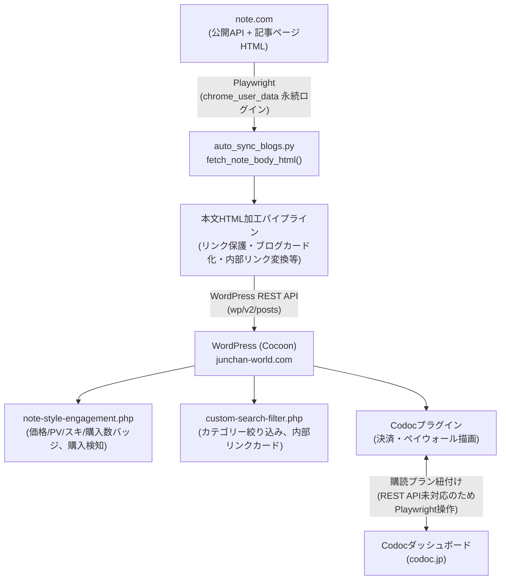

# note-WordPress同期システム 完全運用仕様書（2026-09-20版）

junchan-world.com における note.com ⇔ WordPress（Cocoon + Codoc）自動同期システムの、
現時点（2026-09-20）でのアーキテクチャ・実装済みロジック・既知の制約・日常運用手順をまとめた仕様書。
今後この同期システムに手を入れる際は、まず本書と `CLAUDE.md` を読んでから着手すること。

---

## 目次

1. [システム概要と全体アーキテクチャ](#1-システム概要と全体アーキテクチャ)
2. [今回実装・解決した主要ロジック](#2-今回実装解決した主要ロジック)
3. [note仕様上の制約と差分検知の技術的背景](#3-note仕様上の制約と差分検知の技術的背景)
4. [日常運用バッチコマンド完全ガイド](#4-日常運用バッチコマンド完全ガイド)
5. [将来の「順ちゃんワールド自家出版」への移行方針](#5-将来の順ちゃんワールド自家出版への移行方針)
6. [付録：関連スクリプト一覧](#6-付録関連スクリプト一覧)

---

## 1. システム概要と全体アーキテクチャ

### 1.1 全体フロー

note.com（有料記事プラットフォーム）で執筆・公開した記事を、自己ホストの WordPress
サイト（junchan-world.com、テーマ: Cocoon）へ自動的に複製し、決済機能は Codoc
プラグインに委ねる、という三層構成になっている。



### 1.2 主要コンポーネント

| コンポーネント | 役割 |
|---|---|
| `auto_sync_blogs.py` | 同期処理の中核モジュール。note記事一覧取得、本文取得・加工、WordPress REST API呼び出しの全関数を持つ。他の全スクリプトはこれを `import auto_sync_blogs as core` して再利用する。 |
| `internal_article_links.py` | note/exblog旧記事への内部リンク変換、記事分類（スラッグ規則ベース）。 |
| `link_converter.py` | 現在は `rebuild_toc()`（目次再構築）のみ `auto_sync_blogs.py` から使われている旧世代の変換ロジック集（レガシー、詳細は3章参照）。 |
| `note-style-engagement.php`（WordPress側プラグイン、実体は `note-style-engagement-2/note-style-engagement.php`） | 記事詳細・一覧ページのJS/PHP。価格・PV・スキ・購入数バッジ、Codoc購入検知（`checkCodocPurchaseState`）、購入案内枠（`.nseb-purchase-guide`）を担当。 |
| `custom-search-filter.php`（実体は `custom-search-filter-2/custom-search-filter.php`） | サイドバー絞り込み検索、トップページのカテゴリーフィルタ、ニュース分類。 |
| Codocプラグイン | 決済・ペイウォール本体（サードパーティ製）。本文中の `<!-- wp:codoc/codoc-block {...} -->` ブロックで価格・購読プラン紐付けを制御する。 |

**重要**：`custom-search-filter` / `note-style-engagement` はいずれも WordPress 側に複数の重複フォルダが存在し、
本番稼働中なのはサフィックス `-2` の付いたフォルダのみ。デプロイは zip アップロードではなく
`plugin-editor.php` 経由の直接編集で行うこと（詳細は `CLAUDE.md` および auto-memory
`project_csf_plugin_duplicate_folders` を参照）。

### 1.3 note記事のライフサイクル

1. **新規記事の取り込み**（`sync_new_note_posts`）：note公開APIの記事一覧に対し、WordPress側にまだ存在しない
   スラッグ（`n{key}`）の記事を検出し、本文を取得してWordPressへ新規投稿。有料記事はCodocの
   「購読プラン紐付け」チェックボックスをPlaywrightで自動ON化する。
2. **既存記事の更新追従**（`sync_note_updates`）：本文HTMLを再取得し、前回保存したハッシュ値
   （`auto_sync_state.json`）と比較して差分があれば上書き更新（3章で詳述）。
3. **横断的な安全網**（`relink_touched_posts`）：本文・カテゴリーを書き換えるとCodoc側の
   購読プラン紐付けがサイレントに解除される既知の副作用があるため、更新した記事は必ず
   このタイミングで再紐付けを確認する。

---

## 2. 今回実装・解決した主要ロジック

### 2.1 YouTube / ツイキャス時間指定リンク（`?t=`, `?start=`）保護ロジック

**問題**：note元記事の構造は「①時間指定（`?t=`）付きテキストリンク → ②その直後の実際の
埋め込み動画・カード」という2要素で構成されることがある。当初の実装（コミット `c17bea9`）は
これを「同じURLへの冗長な重複」と誤認し、①のテキストリンクごと削除してしまっていた。これは
指定秒数へ飛ぶための本来必要なリンクを消してしまう重大な仕様誤認で、コミット `a883115` で
是正した。

**正しい実装**（`auto_sync_blogs.py`、`fetch_note_body_html()` 内で順に適用）：

- `protect_video_timestamp_links(html)`：`?t=` を含む YouTube / ツイキャスへの `<a>` タグに
  `target="_blank" rel="noopener noreferrer"` を付与し、リンクは一切削除せずそのまま保持する。
- `ensure_visible_timestamp_link_before_embed(html)`：時間指定付き埋め込み
  （`<figure data-src="...?t=N">`）の直前に、同じURLへのクリッカブルなテキストリンクが
  まだ無ければ新規に生成する（note.com側の編集操作によっては、URL自体が本文の見える位置に
  一切表示されず `data-src` 属性の中にしか残らないケースがあるため）。

**動画重複埋め込みの排除**：note.com側の記事は、著者が同じURLを「参照用テキスト」と
「実際の埋め込みカード」の両方で貼っていることがある。これを闇雲に片方削除するのではなく、
上記2関数により「テキストリンクは常に残す・埋め込みは常に1つだけ」という整流化を行う。
実機検証（`nb8e29ddba925`）で以下を確認済み：

- YouTube: `https://youtu.be/rJ4WqGTeSgE?t=2304` のテキストリンクが存在し、その直後に
  `src="https://www.youtube.com/embed/rJ4WqGTeSgE?rel=0&start=2304"` の埋め込みが1つだけ表示される。
- ツイキャス: `?t=2265` のテキストリンクが存在し、その直後にブログカードが重複なく1件のみ表示される。

全363記事への一括適用は `backfill_video_timestamp_links.py`（本文HTMLハッシュ比較で
実際に差分がある記事のみ更新）で実施済み（成功356件・変更なし2件・新着未同期でスキップ5件、
その5件も後日 `sync_new_note_posts` で正規に新規投稿済み）。

### 2.2 Codoc購入案内枠（`.nseb-purchase-guide`）の配置とアンロック制御

**配置**：`note-style-engagement.php` の `insertPurchaseGuide()` が、Codocブロック
（`.wp-block-codoc-codoc-block`）の直前に「💡 有料記事の閲覧・ご購入について」の
案内枠（サブスク/単品購入の案内＋「ログインして購入済みを復元する」ボタン）を挿入する。

**アンロック時に隠す不具合と修正**：購読中・購入済みユーザーが記事を開いても、この案内枠が
表示され続ける不具合があった。原因は `hideUpsellBanners()`（既存の `.archive-discount-box`
と本文冒頭のサブスク誘導ボックスを隠す関数）が `.nseb-purchase-guide` を対象に含めていな
かったこと。`v4.12.0` で修正。

**さらに深刻な副次バグの発見と修正**：調査の過程で、購入検知の心臓部
`checkCodocPurchaseState()` が `initStatusBar()` 内でしか呼ばれておらず、`initStatusBar()`
は `.nseb-status-bar[data-post-id]` が存在しないと即座に `return` する設計だと判明した。
この要素は、サイドバー検索ウィジェットの `fixSingleArticleTitle()`（`h1.textContent = ...`
による95文字超タイトルの全文置換）に巻き込まれて **ほぼ全ての記事で消失している** ことを
実機確認した。つまり購入検知そのもの（案内枠の自動非表示を含む）が、長らくサイレントに
機能停止していた可能性が高い。`v4.13.0` で `ensurePurchaseDetectionFallback()` を追加し、
`.nseb-status-bar` の生死に依存しない経路（`body` classから取得する `postid`）で購入検知を
独立実行するようにした。

**アンロック判定の3シグナル**（`checkCodocPurchaseState()` 内 `evaluate()`）：

1. `.codoc-buy-wrap`（購入ボタン）が非表示（`display:none`。**存在チェックではなく非表示
   チェック**であることに注意 — 実購入者の実機HTMLでは要素自体は残り、非表示になるだけ
   だったため）。
2. `.codoc-user`（購入者ニックネーム表示）が存在する。
3. `.codoc-entry-body-after`（本文続き差し込み要素）に空でない中身がある。

このいずれか1つでも満たせば「アンロック済み」と判定し、`hideUpsellBanners()` を呼んで
案内枠・誘導ボックスを非表示にする。ウィジェットの描画完了前（プレースホルダ状態）の
誤検知を防ぐため、`.codoc-copyright` の存在、またはコンテナ内HTMLが500文字を超えることの
いずれかを満たすまでは判定自体を保留するガードも入っている。

---

## 3. note仕様上の制約と差分検知の技術的背景

### 3.1 note.comには「更新日時」が一切存在しない（実機調査で確定）

2026-09-20、以下3箇所すべてを実機調査したが、`updated_at` / `modified_at` に相当する
フィールドは一切見つからなかった。

| 調査対象 | 結果 |
|---|---|
| 一覧API `GET https://note.com/api/v2/creators/{user}/contents` | `publishAt` はあるが更新日時なし |
| 個別記事詳細API `GET https://note.com/api/v3/notes/{key}` | `created_at` / `publish_at` はあるが更新日時なし（`member_edit_locked_at` はロック日時であり編集履歴ではない） |
| 記事ページHTMLのOGP等metaタグ | `modified_time` / `dateModified` 等いずれも不在 |

これは note.com プラットフォーム側の仕様上の制約であり、当方のコードでは回避できない。

### 3.2 ハッシュ比較方式を採用している理由と、それに伴う実行時間の制約

上記の制約により「メタデータだけを見て、変更があった記事だけを軽量に絞り込む」ことは
技術的に不可能。そのため `sync_note_updates()` は、対象記事について **毎回 Playwright で
実際に本文HTMLを取得し**、前回保存したハッシュ値（`auto_sync_state.json` の
`note.{key}.content_hash`）と比較して差分の有無を判定する方式を採っている。

> **注意**：「差分がない記事はスキップする」というのは「WordPressへの書き込みをスキップする」
> という意味であり、「差分があるかどうかを判定するための本文取得（重い処理）」自体は
> スキップできない。全件を対象にする限り、記事数に比例した実行時間が必ずかかる。

実測値（`backfill_video_timestamp_links.py` の全件実行、363件、Codoc再紐付け込み）：

- 1バッチ30件の処理に約17分 → 1件あたり平均 **約34秒**
- 363件全件では **約3〜3.5時間**

この制約により、以下の運用方針を確定した：

- 日常の週次バッチ（`週次実行.bat`）には全件差分チェックを含めない（新規記事の取り込みのみ）。
- 全件差分チェックは独立した専用バッチ（`全件差分同期.bat`）として、夜間放置等の
  まとまった時間が取れるタイミングでのみ実行する。

### 3.3 頻繁な全件スクレイピングに対する安全指針（note側アカウントのリスク低減）

本プロジェクトの実行を通じて note.com 側からの明示的なアクセス制限・アカウント停止等は
一度も発生していない。ただし「有料コンテンツプラットフォームに対して自動化ツールで
高頻度に全記事へアクセスする」行為には一般的なリスクが伴うため、以下の既存の安全設計を
維持し、逸脱しないこと。

- **ログイン済みセッションの再利用**：`chrome_user_data` に保存した手動ログイン済みの
  実Chromeプロファイル（`channel="chrome"`）を使い、毎回ログインし直さない。
- **リクエスト間隔**：`REQUEST_DELAY_SECONDS = 1.0` 秒を記事間に必ず挟む（`sync_note_updates`
  等）。バックフィル系スクリプトでも同様に間隔を空けている。
- **全件アクセスの頻度を抑える**：全363件への連続アクセスが必要な処理（`全件差分同期.bat`）は
  **年数回〜数ヶ月に1回程度**の実行に留め、日常的な週次運用には含めない（4章参照）。
- **headlessアクセスへの偏りを避ける**：本番運用スクリプトは `headless=True` で
  Playwrightを起動しているが、これは自動操作の効率化目的であり、リクエストヘッダー等の
  偽装は行っていない（実Chromeバイナリのため通常のブラウザと同じシグネチャで動作する）。

将来的に note.com 側の利用規約・レート制限方針が変わる可能性はあるため、全件差分同期の
実行前後で note.com へのログインが引き続き正常に行えるか（アカウントに異常がないか）を
都度確認する運用が望ましい。

---

## 4. 日常運用バッチコマンド完全ガイド

### 4.1 一覧表

| # | バッチファイル | 対象範囲 | 所要時間目安 | 実行タイミング |
|---|---|---|---|---|
| ① | `週次実行.bat` | note新着記事のみ（未同期分） | 新着なしなら数秒〜数分 | **日常運用**。週1回程度、定期的にダブルクリック |
| ② | `note差分同期（直近90日）.bat` | 公開から90日以内の記事 | 数分程度（対象は通常数十件） | 手動での加筆修正・動画差し替え直後など、任意タイミング |
| ③ | `全件差分同期.bat` | 全note記事（約360件） | 約3〜3.5時間 | **緊急時、または年1回〜数ヶ月に1回**の夜間放置実行 |

いずれもファイルはプロジェクト直下（`F:\ClaudeCode\`）に配置されている。ダブルクリックで
即座に本番実行される（`--execute` 固定。ドライラン確認をしたい場合は、対応する `.py`
スクリプトをコマンドラインから引数無しで直接実行すること）。

### 4.2 ①「週次実行.bat」（日常用）

- **実体**：`python sync_weekly.py --execute`
- **処理内容**：
  1. note.comの新着記事一覧を取得し、WordPress未投稿の記事のみ本文取得・新規投稿
     （動画時間指定リンク保護・Codoc紐付けの最新ロジックが自動適用される）。
  2. 新規投稿した有料記事のCodoc「購読プラン販売」チェックボックスを自動ON化。
  3. サイドバー「キーワードから探す」タグ一覧ページを自動再生成。
  4. 結果サマリー（新規投稿件数等）をコンソール表示 → 完了ビープ音（高音3回）→ `pause`。
- **注意点**：過去記事の加筆修正・動画差し替えはこのバッチの対象外（②③を使うこと）。

### 4.3 ②「note差分同期（直近90日）.bat」（手動修正反映用・軽量版）

- **実体**：`python sync_updated_notes.py --execute --recent-days 90`
- **処理内容**：公開から90日以内の記事のみ、本文HTMLを再取得してハッシュ比較。差分がある
  記事だけWordPress側を上書き更新する。
- **使いどころ**：note側で直近の記事に加筆修正・動画差し替えを行った直後、「反映されて
  いるか確認したい／すぐ反映させたい」ときにこれを実行する。
- **90日より古い記事の修正**：このバッチの対象外。個別に強制反映したい場合は
  `python auto_sync_blogs.py --only update-note --key <note記事キー>` を使うか、③を使う。

### 4.4 ③「全件差分同期.bat」（緊急・低頻度の夜間放置用）

- **実体**：`sync_updated_notes.py --execute --batch-size 30` を、バッチファイル内の
  `goto` ループで「未処理が無くなるまで（終了コード2の間）」自動的に繰り返す。
- **メモリ対策**：30件処理するごとにプロセス自体を完全終了させ、OSレベルでメモリを
  完全解放してから次のバッチを起動する。これは、363件規模の連続 Playwright 操作で
  実際にメモリ逼迫によりバックグラウンドプロセスが強制終了する事故が2回発生した
  経緯を踏まえた設計（`backfill_video_timestamp_links.py` の運用で確立した方式）。
- **進捗管理**：一時的な進捗ファイル `sync_updated_notes_progress.json` に「今回の
  全件確認サイクルで確認済みの記事キー」を記録し、サイクル完了時に自動削除する。
  夜間に途中で止まっても、再度ダブルクリックすれば続きから再開できる。
- **完了時**：高音ビープ3回 → `pause`。**異常終了時**：低音ビープ1回 → `pause`
  （この場合はコンソールに表示されたエラー内容を確認すること）。
- **実行頻度の目安**：3章で述べた通り年数回〜数ヶ月に1回程度。日常的に回す運用は
  想定していない。

---

## 5. 将来の「順ちゃんワールド自家出版」への移行方針

### 5.1 note依存脱却のメリット

現行システムは note.com を「一次執筆・公開の場」とし、WordPress を「複製先」として
Playwright スクレイピングで同期する構成になっている。この構成には以下の構造的コストが
伴う：

- 3章で述べた通り、更新日時メタデータの欠如により差分検知が本質的に重い処理になる。
- note.com側のDOM構造・APIレスポンス形式が変わるたびに、本プロジェクトの多数の変換
  ロジック（`link_converter.py`、`convert_external_article_embeds_to_blogcards` 等）が
  追従を迫られる（実際、本書2章の不具合の多くは note.com 側の複雑な内部構造に起因する）。
- 全件差分同期に3時間規模の実行時間がかかり、note側アカウントへの負荷も無視できない。

**「順ちゃんワールド自家出版」**（note.com を経由せず、WordPress を一次執筆の場にする）
へ移行すれば、これらの構造的コストがすべて解消する。差分検知は不要になり（WordPress自身の
更新履歴がそのまま真実になる）、スクレイピング系の変換ロジック一式が不要になり、実行時間の
制約もなくなる。

### 5.2 WordPressブロックエディター＋Codocブロックの活用手順（概要）

Codocのペイウォールは、WordPress側の投稿本文に埋め込む以下の形式のブロックコメントで
制御されている（`auto_sync_blogs.py` の `CODOC_BLOCK_ATTRS_TEMPLATE` / `generate_perfect_wp_xml.py`
の `make_codoc_block()` と共通仕様）：

```html
<!-- wp:codoc/codoc-block {"showPrice":true,"price":300,"limited":false,"limitedCount":10,"affiliateMode":false,"affiliateRate":"0.0500","showSupport":false,"showPaywalledSupport":false,"statusLimited":false,"subscriptions":{"4133":true},"version":"0.9.60"} -->
<!-- 本文のうち、ここより後がペイウォールで保護される -->
<!-- /wp:codoc/codoc-block -->
```

自家出版で新規記事を書く場合の推奨手順：

1. WordPressの通常のブロックエディターで本文を執筆する（note.comの制約を離れ、
   Cocoonテーマの全ブロック・ショートコードが自由に使える）。
2. 無料公開したい部分（導入・要約等）を書いた直後に、上記Codocブロックを挿入する。
   `price` に単品購入価格（円）を設定し、`subscriptions` の `"4133": true` で
   既存の月額読み放題プラン（4133番）に必ず紐付ける。
3. Codocブロックより後に、有料部分の本文を続けて書く。
4. 保存後、Codocダッシュボード（codoc.jp）側でエントリーが正しく作成され、
   「購読プラン販売」チェックボックスがON（`subscriptions` 属性だけでは
   サーバー側の実際の紐付けレコードに反映されないため、既存の `backfill_codoc_subscription_linkage.py`
   の仕組みで別途確認・自動修正する運用を維持すること。詳細は同スクリプトの
   docstringおよび `CLAUDE.md` 18項を参照）。
5. `note_full_title` 等のnote由来メタデータは自家出版記事には不要（投稿タイトルが
   そのまま正式タイトルになるため、青枠「元記事確認用フルタイトル」ボックスの
   自動挿入ロジックは自家出版記事には適用しないこと）。
6. 動画埋め込みが必要な場合、時間指定URLは本仕様書2.1の教訓に従い、必ず
   クリッカブルなテキストリンク（`target="_blank" rel="noopener noreferrer"`）を
   埋め込みプレーヤーの直前に残す（自家出版では手動で書くため、note.com側の
   自動生成物由来の重複問題自体が発生しない点が大きな利点）。

**移行の進め方**：既存の約360件のnote記事は当面現行の同期システムで維持しつつ、
新規記事から段階的に自家出版へ切り替えていくのが現実的。完全移行後は、本書3・4章の
差分同期の仕組み自体が不要になるため、`sync_updated_notes.py` / `全件差分同期.bat` 等は
アーカイブしてよい（`sync_weekly.py` の新規記事取り込み機能のみ、しばらくは
note.com既存読者の並行運用のために残す判断もありうる）。

---

## 6. 付録：関連スクリプト一覧

| ファイル | 役割 |
|---|---|
| `auto_sync_blogs.py` | 同期処理の中核モジュール（全処理の実行、`--only`で個別実行、`--key`で特定記事の強制更新も可能） |
| `sync_weekly.py` | 週次運用：新規記事同期＋タグ一覧再生成（`週次実行.bat` の実体） |
| `sync_monthly_maintenance.py` | 月次運用：直近4ヶ月の更新追従＋Codoc90日値下げ（`月次メンテ.bat` の実体） |
| `sync_updated_notes.py` | 差分自動検知・更新（デフォルト全件、`--recent-days`で期間限定可）。`note差分同期（直近90日）.bat` / `全件差分同期.bat` の実体 |
| `backfill_external_blogcards.py` | note外部リンク埋め込みの一括ブログカード化（過去記事バックフィル用） |
| `backfill_video_timestamp_links.py` | 動画時間指定リンク保護ロジックの全記事一括バックフィル（実行済み、通常は再実行不要） |
| `backfill_codoc_subscription_linkage.py` | Codoc購読プラン紐付けの確認・自動修正（2FA必要、30日毎に信頼デバイス再認証） |
| `backfill_codoc_cache.py` / `backfill_codoc_price_and_likes.py` / `backfill_codoc_verified_purchases.py` | Codoc価格・購入数・スキ数キャッシュの補正系スクリプト |
| `internal_article_links.py` | note/exblog内部リンクのカード化、記事分類（スラッグ規則ベース） |
| `link_converter.py` | 旧世代の変換ロジック集（現在は `rebuild_toc()` のみ現行パイプラインで使用） |
| `note-style-engagement.php`（本番: `note-style-engagement-2`） | 価格/PV/スキ/購入数バッジ、Codoc購入検知、購入案内枠制御 |
| `custom-search-filter.php`（本番: `custom-search-filter-2`） | サイドバー絞り込み、トップページカテゴリーフィルタ、ニュース分類 |

関連する詳細な不具合対応履歴・教訓は `CLAUDE.md`（プロジェクトルート）を参照。
本書は「現時点でのシステム全体像・運用ガイド」を俯瞰するためのドキュメントであり、
個別の不具合修正の経緯・実機調査の詳細は `CLAUDE.md` の各項目が一次情報源となる。
